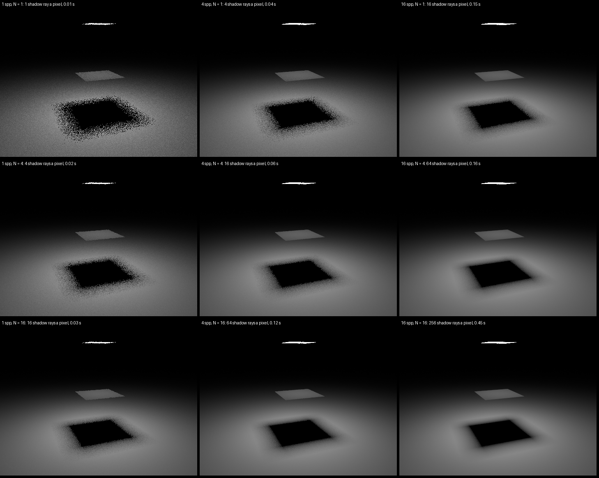
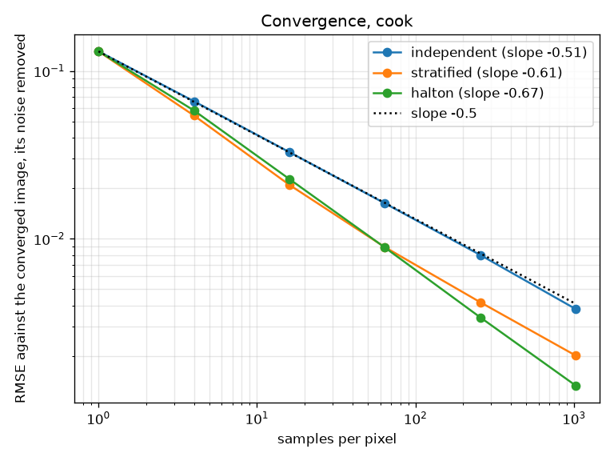
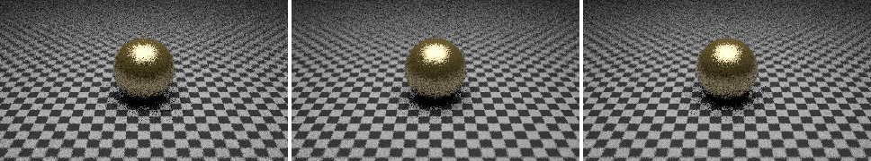
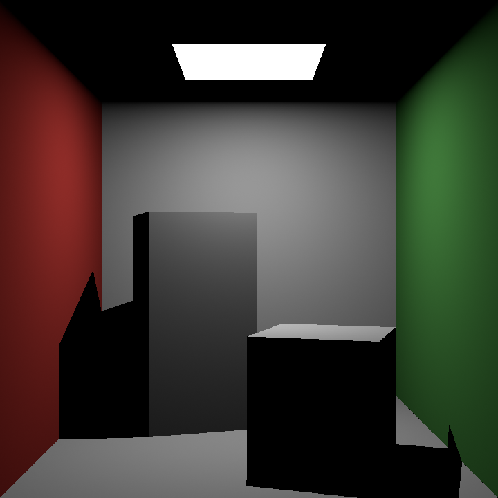
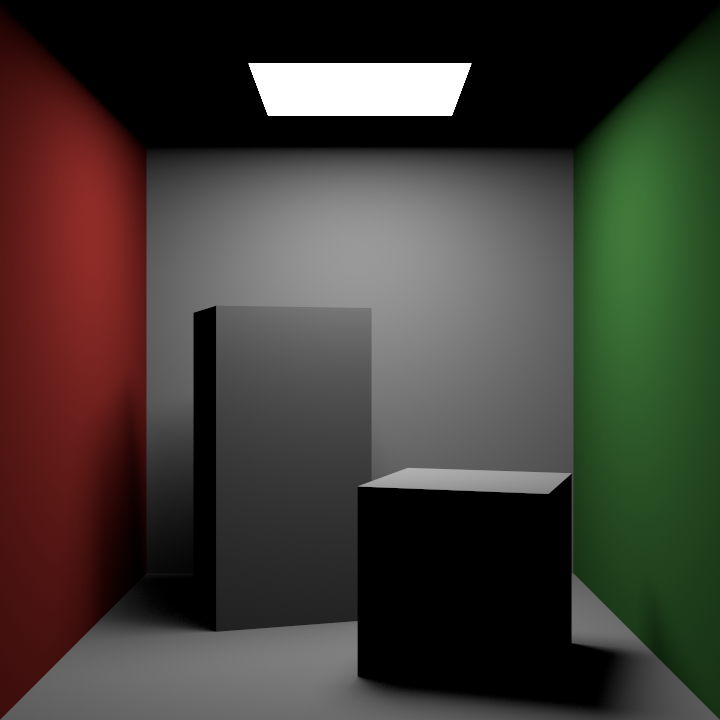
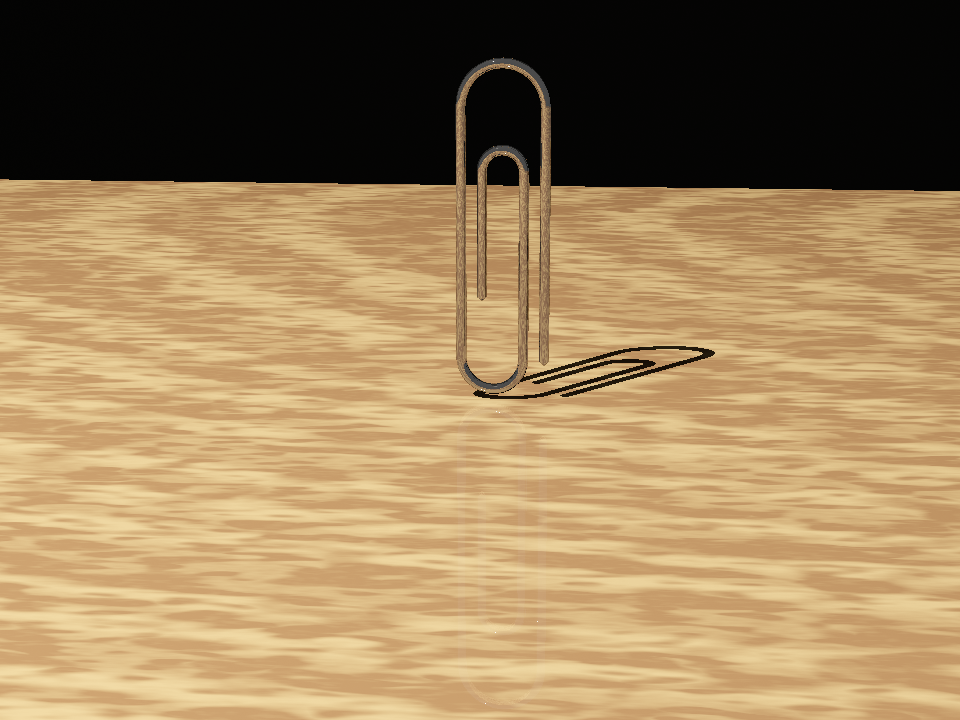
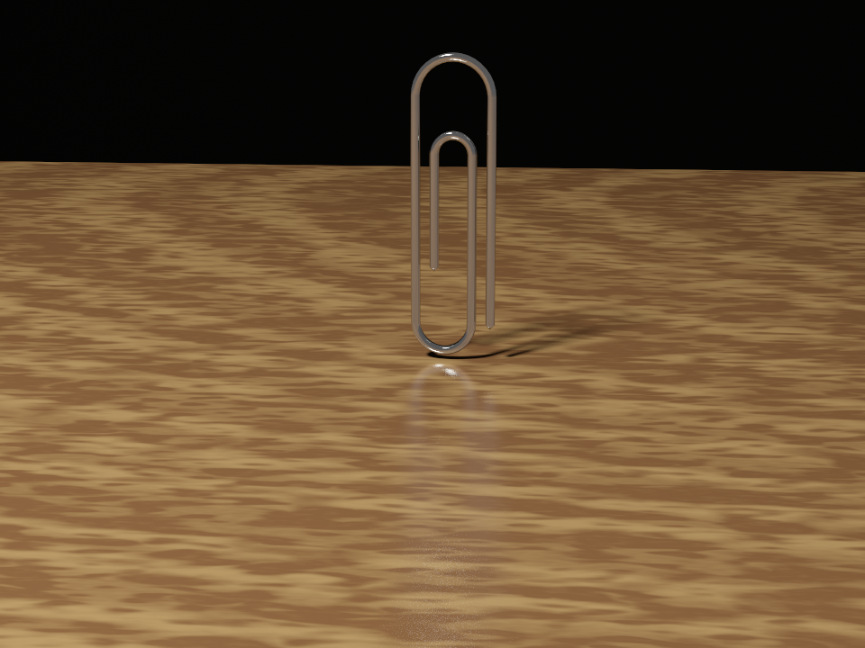
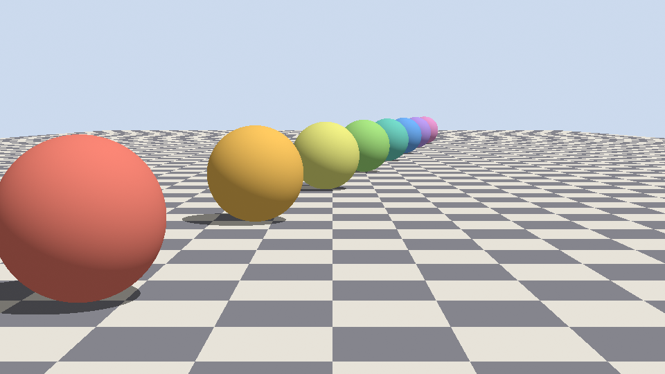
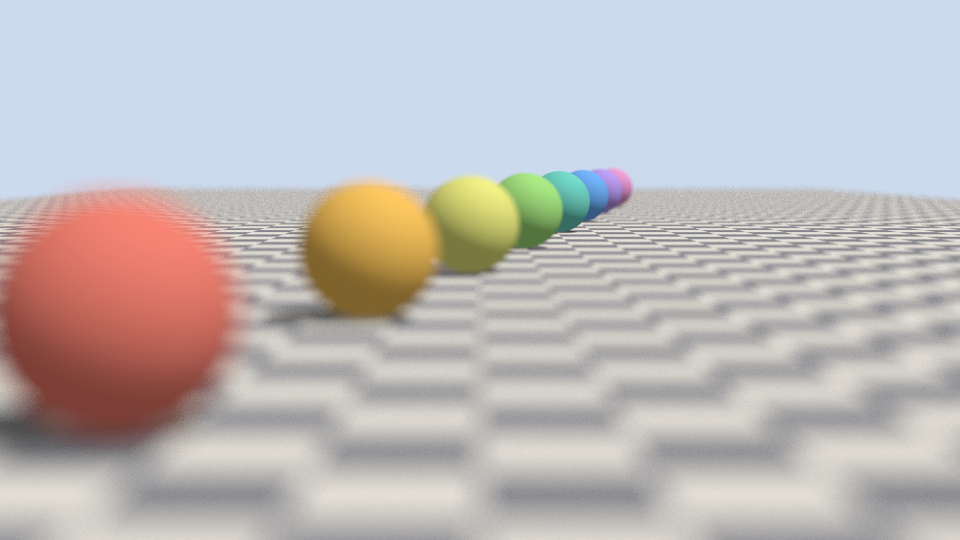

# ECE/CS 285 — Homework 3 Write-up  

## 1. Overview

For HW3, we extended HW2 Whitted ray tracer with a separate Cook distributed ray-tracing integrator. Instead of evaluating every pixel, lens position, light, and glossy reflection using a single deterministic ray, the Cook integrator estimates the relevant integrals by sampling. The implementation covers antialiasing, thin-lens depth of field, area-light sampling and next-event estimation, environment-map importance sampling, glossy reflection, clear and frosted transmission, and ambient occlusion. The original Whitted integrator remains selectable for comparison.

The completed test and study tiers were compared with the supplied reference renders.

## 2. Warp Sampling Tests

Ran `python tools/warptest.py all` with one million samples per warp. All six tested warps passed the chi-square goodness-of-fit and PDF checks.

| Warp | Chi-square | Degrees of freedom | p-value | PDF error | Result |
|---|---:|---:|---:|---:|---|
| Uniform disk | 2069.7 | 2039 | 0.313 | 4.0e-08 | PASS |
| Cosine-weighted hemisphere | 3349.7 | 3200 | 0.0321 | 8.7e-08 | PASS |
| Uniform sphere | 3201.5 | 3199 | 0.484 | 4.0e-08 | PASS |
| Uniform cone (cos theta max = 0.8) | 3201.1 | 3199 | 0.486 | 6.3e-09 | PASS |
| Uniform triangle | 1290.4 | 1274 | 0.369 | 0.0e+00 | PASS |
| Phong lobe (exponent 20) | 3174.5 | 3080 | 0.115 | 1.4e-07 | PASS |

The p-values do not indicate a statistically significant mismatch at the test's pass criterion. The small PDF errors also support the consistency of the sampling transformations and their reported densities. We additionally generated scatter and visualization outputs with `warptest.py`; the disk visualization matched the supplied reference (RMSE 0.00013).

## 3. Area-Light Sampling and Next-Event Estimation

We validated the area-light estimator with `python tools/area_light_test.py --rt ./build/gauchoRT`. The test compared `QuadLight` against an exact reference and examined bias and error at increasing sample counts.

| Samples per pixel | RMSE | Ratio to previous RMSE | Test |
|---:|---:|---:|---|
| 4 | 0.02006 | — | PASS |
| 16 | 0.00999 | 2.01 | PASS |
| 64 | 0.00503 | 1.99 | PASS |
| 256 | 0.00252 | 1.99 | PASS |

Every tested sample count passed the statistical mean-difference check; **0 of 480 blocks** exceeded four standard errors in each run. Quadrupling the number of samples reduced RMSE by almost exactly a factor of two, consistent with the Monte Carlo behavior \(\mathrm{RMSE}\propto N^{-1/2}\).



*Figure 1. LightSamples: combinations of pixel samples and light samples, illustrating the trade-off between shadow-ray count and visible noise.*

### Why next-event estimation is unbiased

At a surface point \(P\), direct illumination can be written as an integral over incident light directions:

\[
L_{\mathrm{direct}}(P)=\int_{\Omega} f_r(P,\omega_i,\omega_o)\,L_i(P,\omega_i)\,V(P,\omega_i)\,|N\cdot\omega_i|\,d\omega_i.
\]

When a direction is sampled from a nonzero probability density \(p(\omega_i)\), next-event estimation contributes

\[
\widehat L_{\mathrm{direct}}=\frac{1}{M}\sum_{k=1}^{M}\frac{f_r(P,\omega_k,\omega_o)\,L_i(P,\omega_k)\,V(P,\omega_k)\,|N\cdot\omega_k|}{p(\omega_k)}.
\]

Taking the expectation cancels the sampling density: \(\mathbb E[g(\omega)/p(\omega)]=\int g(\omega)\,d\omega\). Consequently, the estimator is unbiased when the PDF correctly describes the generated samples, the visibility term is evaluated consistently, and the sampling distribution gives nonzero probability wherever the integrand contributes. Importance sampling changes the variance, not the expected illumination. Visibility failures and cutout samples contribute zero rather than being silently resampled.

## 4. Sampler Convergence Study

We ran `python tools/convergence.py --rt ./build/gauchoRT` for independent, stratified, and Halton sampling at 1, 4, 16, 64, 256, and 1024 spp. The supplied 16,384-spp reference has its own estimated image noise of 0.00102, which the script subtracts in quadrature.

| Sampler | 1 spp | 4 spp | 16 spp | 64 spp | 256 spp | 1024 spp |
|---|---:|---:|---:|---:|---:|---:|
| Independent | 0.13090 | 0.06598 | 0.03283 | 0.01626 | 0.00800 | 0.00381 |
| Stratified | 0.13090 | 0.05425 | 0.02094 | 0.00891 | 0.00418 | 0.00201 |
| Halton | 0.13101 | 0.05814 | 0.02269 | 0.00887 | 0.00340 | 0.00133 |

| Sampler | Fitted slope (all spp) | Low-spp slope | High-spp slope |
|---|---:|---:|---:|
| Independent | -0.51 | -0.50 | -0.52 |
| Stratified | -0.61 | -0.66 | -0.54 |
| Halton | -0.67 | -0.63 | -0.68 |



*Figure 2. Log-log RMSE as a function of samples per pixel. The fitted slopes are shown in the table above.*



*Figure 3. Four-samples-per-pixel comparison of independent, stratified, and Halton sampling.*

Independent sampling follows the expected \(N^{-1/2}\) error reduction, reflected in its slope of approximately -0.5. Stratification reduces clustering and improves performance, especially at low sample counts. The low-discrepancy Halton sampler achieves the steepest overall fitted slope (-0.67); at 1024 spp its RMSE (0.00133) is about 35% of independent sampling's RMSE (0.00381). The exact slopes depend on the scene and sample-count range, but these measurements show a clear benefit from more evenly distributed samples.

The script also generated `renders/2_Cook/2_StudyScenes/convergence.csv` with the measurements used for the plot.

## 5. Glossy Lobe Sampling and Its Weight

The Cook integrator samples a reflected direction from a normalized Phong lobe centered on the ideal mirror direction. For the handout's glossy-lobe model, the angular distribution appearing in the scattering contribution is the same normalized distribution used as the sampling PDF. In the Monte Carlo throughput,

\[
\text{weight}=\frac{f_r(\omega_i,\omega_o)\,|N\cdot\omega_i|}{p(\omega_i)},
\]

the lobe distribution cancels its sampling PDF, and the geometric cosine is already accounted for by the model's directional weighting. The remaining multiplier is **the Fresnel factor \(F\)**. Multiplying by another cosine or dividing by the lobe PDF a second time would incorrectly darken or brighten glossy reflections. Reflection directions that are geometrically invalid are rejected rather than incorrectly used.

This behavior was checked against the provided tests: `GlossyFurnace` (RMSE 0.00000), `GlossySweep` (0.00003), `MirrorLamp` (0.00002), and `Paperclip` (0.00004) all passed.

## 6. Whitted vs. Cook: Three Scene Comparisons

The renderer supports both `--integrator whitted` and `--integrator cook`, allowing direct comparisons between the two rendering methods. We selected three scenes—CornellBox, Paperclip, and DepthOfField_mid—to demonstrate the effects introduced by distributed ray tracing. Each scene was rendered using both integrators at the same image resolution to ensure a fair comparison. The resulting images are shown side by side below, highlighting differences in soft shadows, glossy reflections, and depth of field.

### 6.1 CornellBox — soft shadows

| Whitted | Cook |
|---|---|
|  |  |

The Whitted model approximates each light by a single lighting direction, producing sharper shadow boundaries. Cook samples across the emitting area, integrating multiple incident directions and producing soft penumbrae. The hard shadows of CornellBox have been transformed into soft penumbrae.

### 6.2 Paperclip — glossy reflections

| Whitted | Cook |
|---|---|
|  |  |

Whitted follows idealized mirror directions, whereas Cook samples a finite reflection lobe for rough surfaces, so reflected shapes can appear blurred rather than perfectly sharp. The desktop reflection of Paperclip becomes blurry and the shadows become softer.

### 6.3 DepthOfField_mid — thin-lens depth of field

| Whitted | Cook |
|---|---|
|  |  |

Whitted uses a pinhole camera and keeps objects at different depths geometrically sharp. Cook samples positions on a finite camera aperture while aiming at a focus plane; objects away from the focus distance appear blurred. The red ball in the foreground and the chessboard in the foreground of the "DepthOfField_mid" image are clearly out of focus, while the middle and rear parts are much clearer.

## 7. Implementation Challenges and Debugging

The hardest parts were maintaining **deterministic sampling order** across the pixel, lens, environment, light, glossy-lobe, and ambient-occlusion dimensions, and correctly converting sampling PDFs between area and solid angle. This mattered because even a plausible-looking image could differ from the reference if random-number dimensions were consumed in the wrong order.

Sphere emitters were particularly challenging because sampling and visibility handling differ depending on whether the shading point is inside or outside the sphere. We needed to handle both cases correctly and ensure that shadow rays did not incorrectly treat the light source itself as an occluder. During debugging, `SphereLight` and `SphereLightInside` initially produced zero radiance due to an incomplete sphere-light sampling path. After correcting the sampling and visibility logic, both scenes matched the reference renders.

## 8. Final Validation and Hero Renders

The completed renderer was validated using the following tests:

- `python tools/warptest.py all`: six of six warp tests passed.
- `python tools/area_light_test.py --rt ./build/gauchoRT`: all four sample counts passed the statistical checks.
- `python tools/convergence.py --rt ./build/gauchoRT`: convergence results and both required figures generated.
- `python tools/compare.py renders/2_Cook reference_renders/2_Cook`: 49 passed, 0 failed.
- `Candy --time-limit 60` followed by `compare.py --partial`: PASS, RMSE 0.00116 over approximately 2% of pixels rendered.

All seven required Cook Hero Scenes were rendered successfully and passed their reference-image comparisons. The resulting images met the specified RMSE threshold of 0.010, as summarized below.

| Hero Scene | RMSE | Threshold | Result |
|---|---:|---:|---|
| BarcelonaPavilion | 0.00158 | 0.010 | PASS |
| Candy | 0.00113 | 0.010 | PASS |
| Chess | 0.00005 | 0.010 | PASS |
| ChopperTitan | 0.00095 | 0.010 | PASS |
| Crown | 0.00120 | 0.010 | PASS |
| FishyCat | 0.00078 | 0.010 | PASS |
| MagicalClock | 0.00077 | 0.010 | PASS |


After all seven required Hero images and `FrostedEarthMovie.mp4` are present, run the instructor's completeness check:

```bash
python tools/compare.py renders/2_Cook reference_renders/2_Cook \
  --require-all \
  --exclude "4_ExtraCreditScenes/*" \
  --exclude "1_TestScenes/Convergence_ref.png"
```

The final reference-image comparison reported **49 passed and 0 failed**. All hero images passed their specified RMSE threshold of 0.010.

## 9. Reproducibility and Included Evidence

The project README documents the actual build and run commands. This write-up refers to these outputs inside the submission folder:

- `renders/2_Cook/2_StudyScenes/LightSamples.png`
- `renders/2_Cook/2_StudyScenes/convergence.csv`
- `renders/2_Cook/2_StudyScenes/convergence.png`
- `renders/2_Cook/2_StudyScenes/SamplerGallery.png`
- Required test, study, and Hero PNG files, plus `FrostedEarthMovie.mp4`
- `reports/warptest.log`
- `reports/area_light_test.log`
- `reports/final_compare.log`

The source archive should omit `build/`, `models/`, `textures/`, and `reference_renders/`, as specified by the assignment. Diagnostic PFMs, AOVs, diff images, and individual movie frames are not required deliverables.